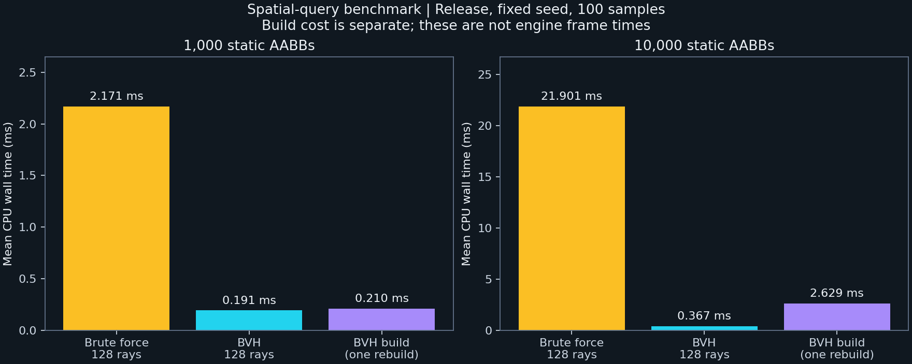
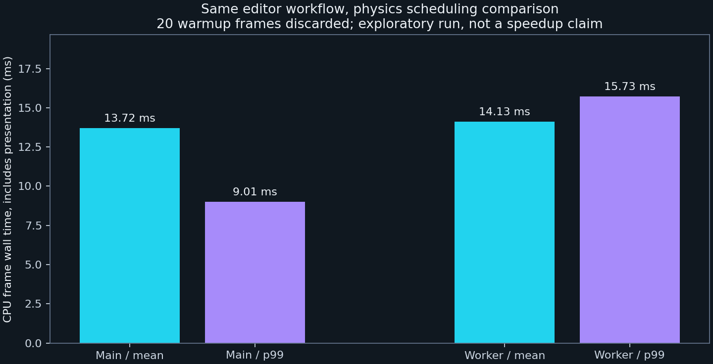

# GD-Engine

A game engine I'm building from scratch in modern C++, and **CourseMaker** — a
visual shooting-course authoring tool built on top of it.

The idea: a custom engine plus a no-code editor where you create, configure,
save, share and play your own first-person shooting courses.

## Project C: performance, concurrency and netcode

The v2 preview adds a work-stealing job system, background image previews,
BVH-accelerated editor selection, editable A* navigation targets, and a real UDP
loopback lab with prediction, interpolation, acknowledgements and packet-loss
simulation. Optional Tracy instrumentation and Google Benchmark targets make
the implementation measurable. Windows/Linux CI and sanitizer workflows are
included; recorded results distinguish local Windows, Linux CI and hardware checks.

See [Project C implementation, experiments and limitations](docs/PROJECT_C.md).
Download the [Windows and Linux preview builds](https://github.com/DivyanshuKumarSharma/GD-Engine-Proper/releases/tag/v2.0.0-project-c-preview.1).
The release's [CI run](https://github.com/DivyanshuKumarSharma/GD-Engine-Proper/actions/runs/45915230921)
passed both desktop builds, ASan, TSan (including ten stress repetitions), and
Google Benchmark. A [four-minute demonstration guide](docs/DEMO_WALKTHROUGH.md)
connects the implementation to the recorded evidence.
The Windows Release build passes six CTest suites, including the real editor
workflow. The systems suite alone performs 15,314 checks. Recorded experiments
use an Intel x64 machine with 16 logical processors and MSVC 19.44; these are
workload-specific results, not universal FPS claims.




Raw CSVs, Google Benchmark JSON, and Tracy captures live in
[`docs/evidence/`](docs/evidence/). Worker physics remains opt-in because
scheduling a small simulation does not guarantee faster frames.

---

## Two applications

| | |
|---|---|
| **CourseMaker** | The editor. A dockable desktop tool — 3D viewport, scene hierarchy, inspector, asset browser, course/drill organizer — for building courses without writing code: place targets, configure movement and weapons, playtest, save, reopen. |
| **Course player** (`GameDevelopmentProject`) | The standalone runtime that plays a course project through the same simulation code the editor authors. Ships with an example course (Target Practice → Speed Course → Final Test). |

See [`docs/CREATOR_GUIDE.md`](docs/CREATOR_GUIDE.md) for a walkthrough and
[`docs/SHOOTING_COURSE_MAKER.md`](docs/SHOOTING_COURSE_MAKER.md) for the full
design, current status and roadmap.

---

## The engine

Written from the ground up — no engine framework underneath.

- **Rendering** — OpenGL 3.3 core, a render queue, custom shaders, an offscreen
  render target the editor draws the scene into.
- **Scene** — component-based game objects, JSON serialization, prefabs, stable
  object ids.
- **Physics** — Bullet: kinematic character controller, rigid bodies, raycasts,
  trigger volumes.
- **Audio** — miniaudio.
- **Text / UI** — FreeType glyph atlas, an in-engine canvas/button system.
- **Assets** — glTF/GLB model loading (cgltf), PNG/JPEG images (stb_image),
  portable project folders that resolve every reference relative to the project.
- **Editor layer** — Dear ImGui (docking) + ImGuizmo, compiled separately and
  linked only into CourseMaker; the runtime has no dependency on it.

---

## Tech stack

| | |
|---|---|
| Language | C++17 |
| Build | CMake (≥ 3.16) |
| Graphics | OpenGL, GLFW, GLEW, GLM |
| Physics | Bullet 3.25 |
| Audio | miniaudio |
| Text | FreeType |
| Data | nlohmann/json |
| Editor UI | Dear ImGui (docking) + ImGuizmo |

All third-party libraries are vendored under `engine/thirdparty/` — no package
manager required. Full matrix in
[`docs/FORMATS_AND_DEPENDENCIES.md`](docs/FORMATS_AND_DEPENDENCIES.md).

---

## Build

```bash
cmake -S . -B build
cmake --build build --config Debug
ctest --test-dir build -C Debug --output-on-failure
```

Then:

```bash
build/Debug/CourseMaker.exe                  # the editor (opens the example project)
build/Debug/CourseMaker.exe path/to/project  # open a specific project folder
build/Debug/GameDevelopmentProject.exe       # play the example course
build/Debug/GameDevelopmentProject.exe path/to/project   # play any CourseMaker project
```

On Windows, `gen_proj_vs2022.bat` generates a Visual Studio 2022 solution.
Details and headless/CI flags in [`docs/BUILD.md`](docs/BUILD.md).

**Platforms:** developed and verified on Windows 11. macOS / Linux code paths
exist but are currently unverified.

---

## Repository layout

| Path | |
|---|---|
| `engine/source/` | engine — rendering, scene, physics, audio, text, IO |
| `engine/thirdparty/` | vendored dependencies |
| `source/` | game runtime — course lifecycle, drills, objectives, targets, weapons, player, HUD |
| `source/editor/` | CourseMaker — the editor application |
| `source/project/` | project / course document model (shared by editor and runtime) |
| `assets/` | the bundled example project |
| `tests/` | test suites (`course_tests`, `editor_tests`, `gameplay_tests`) |
| `docs/` | design, creator guide, build, format matrix |

---

## Status

The engine is functional and the editor is a working prototype covered by six
automated suites (`ctest`): systems/concurrency, impaired UDP loopback, course logic, project/persistence/movement, gameplay
logic (weapon fire timing, magazines, paths, bindings), and an end-to-end
workflow that drives the real editor — open a project, place targets, undo/redo,
save, **enter Play, let a real `CourseDirector` run intro → countdown → drill →
completion → results**, switch weapons and hold the trigger through the real
weapon logic, watch a moving target travel its path, pause/resume the drill's
music, stop, and confirm the authored scene came back untouched.

Working end to end today:
- Author an environment + any number of drills, each with its own targets,
  objectives, music, movement override and allowed weapons.
- **Weapons**: every drill spawns the player with its loadout — pistol, SMG,
  automatic rifle, sniper — each with its own fire mode (semi / auto / 3-round
  burst), cadence, magazine and reload, spread that blooms under sustained fire,
  recoil, sniper aim zoom, damage, model and sounds. Switch with 1–9 or the
  mouse wheel, reload with R (all rebindable, press-to-bind in the editor), with
  an ammo/weapon HUD and a crosshair that opens with the real spread.
- **Targets**: circle / square / triangle / image / model / knock / reach /
  armored (multi-hit health) targets; moving targets on multi-waypoint paths
  (presets, ping-pong / loop / once, easing, start delay, constant travel speed)
  with a live path preview in the viewport.
- **Audio**: per-drill music that starts at GO, pauses and resumes with the game
  and stops on completion; overlapping weapon sounds (voice pooling);
  master / music / effects mix.
- Playtest one drill or the whole course inside the editor, or play the project
  standalone: `GameDevelopmentProject <project-folder>` runs the same setup.
- New projects are playable immediately — spawned player, default key bindings
  and default assets are seeded automatically.
- Save, close, reopen, and move the whole project folder elsewhere.

Still in progress (tracked in `docs/SHOOTING_COURSE_MAKER.md`): the asset
**import** pipeline (drag-drop placement of project assets works; copying an
external file into the project with validation and relinking doesn't yet),
Blender import, per-pixel (alpha-tested) hits on image targets, and per-drill
weapon/movement overrides in a *standalone* whole-course run (the editor's drill
playtests honour them; the standalone player uses the project defaults).
