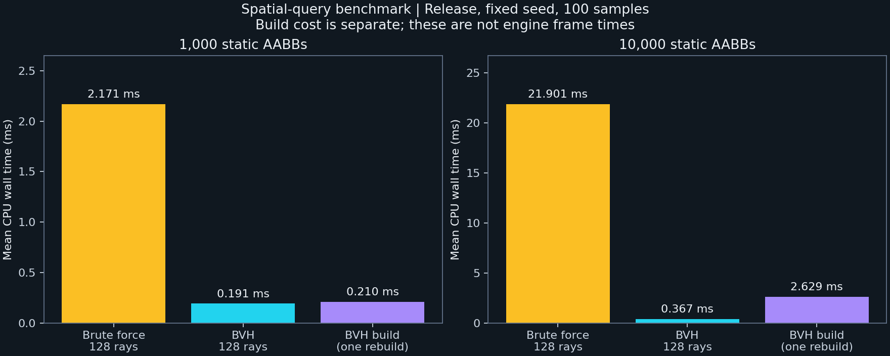
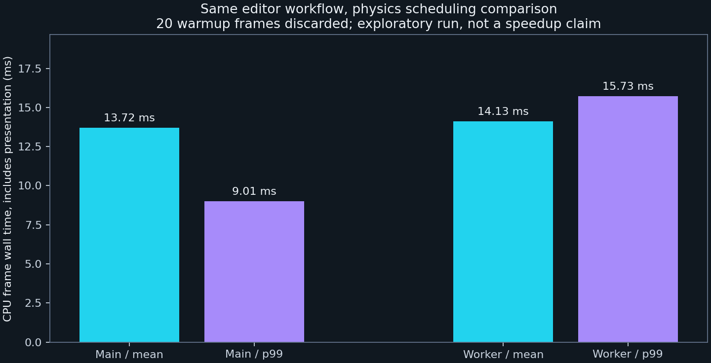
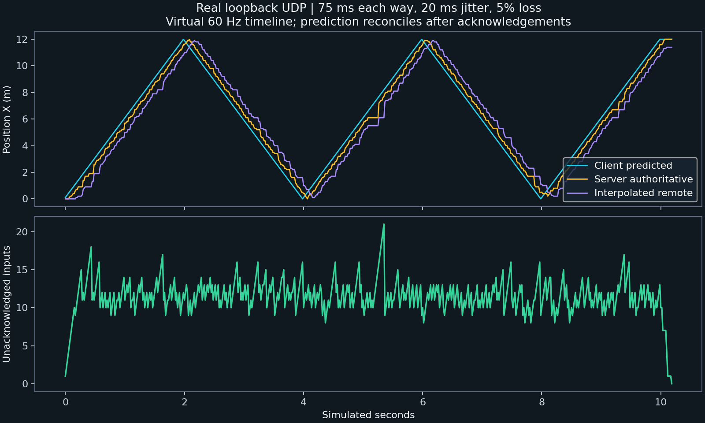

# GD-Engine v2: Project C

Project C adds independently testable systems programming work to the existing
CourseMaker editor and playable shooting course. The prior editor/gameplay work
in this checkout is retained. This is a preview implementation, not a claim that
every portfolio gap is already closed.

## Implementation and evidence

| Area | Implementation | Verification / boundary |
|---|---|---|
| Concurrency | Work-stealing job pool, per-worker deques, cooperative waits, exception propagation and draining shutdown | Windows stress tests: concurrent producers, nested waits with one worker, drain and exceptions. Linux TSan is configured, not yet verified locally. |
| Streaming | Bounded background image reads/decodes for hovered asset previews; main-thread GPU upload | Integrated into the editor. Regular synchronous scene loading remains available. This is not a complete async world-streaming system. |
| Physics scheduling | Optional Bullet step as a job, joined before queries and callbacks | Real editor workflow passes with both paths. One exclusive Bullet world; no claim of parallel Bullet simulation or guaranteed speedup. |
| Spatial algorithms | Median-split BVH, finite-ray slab tests, cached editor picking with local-space narrow phase | 2,000 randomized ray comparisons with brute force, boundary cases and separate build-cost measurements. Bullet already has its own DBVT. |
| Navigation | Four-neighbour A* with an admissible Manhattan heuristic; Dijkstra reference | 100 seeded random grids compared for equal path length; editable A* target grid, visible route, serialized round trip in the editor workflow. |
| Networking | Nonblocking IPv4 UDP, explicit versioned wire format, input ACKs/retries, prediction/reconciliation, snapshot interpolation, bounded impairment queues | Real loopback sockets with 75 ms one-way latency, 20 ms jitter and 5% loss; 600 inputs acknowledged, final position error 0 in the recorded run. |
| Profiling | Tracy zones and frame markers, CSV frame recorder, Google Benchmark target and portable benchmark runner | Windows builds and benchmark output recorded. Raw evidence is in `docs/evidence`. |
| Delivery | Windows/Linux CI matrix, separate ASan/TSan jobs, portable ZIP packager and verified-CI draft-release workflow | Local Windows validation is available. Remote CI, Linux execution and publication must be confirmed separately. |

## Try it

Build the normal project and run `CourseMaker`. Use **Add > Targets > A* Navigation
Target**. Select the target and scroll to its MovingTargetComponent inspector.
Click the small grid cells to create/remove blocked cells. Green and violet mark
the endpoints; the viewport displays the computed route. Play a drill to see the
target follow it. Convert the route to waypoints to edit the points directly.
Grid occupancy is explicit authored data; walls are not automatically rasterized.
Cell dimensions/clearance must fit the target. This does not implement navmeshes,
dynamic avoidance or a collision-proof character controller.

Hover an image in Assets for its asynchronously loaded preview. File reads are
limited to 64 MiB, dimensions to 4096 per side, and in-flight decodes to eight.
Each request captures its project path, avoiding a race with project switching.
Failed requests are logged and cached until the texture cache is cleared.

### Lightweight systems build (no graphics/audio dependencies)

```sh
cmake -S . -B build-systems -DGD_SYSTEMS_ONLY=ON -DCMAKE_BUILD_TYPE=Release
cmake --build build-systems --config Release --parallel 2
ctest --test-dir build-systems -C Release --output-on-failure
```

On Windows, multi-configuration generators put executables under `Release/`.
Ninja and Linux single-configuration builds put them directly in the build folder.

```sh
./build-systems/netcode_demo --ticks 600 --latency 75 --jitter 20 --loss 0.05 --csv network.csv
./build-systems/systems_bench > algorithms.csv
```

The network demo owns two real UDP loopback endpoints in one process. A virtual
60 Hz clock makes fault tests fast; it is **not** an actual measured Internet RTT.
The snapshot tick is the processed input sequence. Unacknowledged inputs are
resent every six ticks; the authority buffers/reorders at most 256 inputs and
applies each once. Snapshots arrive every three ticks. The renderer samples a
six-tick interpolation delay and clamps outside its 64-snapshot history.

Malformed/oversized packets and invalid/non-finite fields are rejected. The demo
checks sender endpoints. The library is deliberately not wired into multiplayer
shooting: authentication, session negotiation, server-owned real-time movement,
clock synchronization, bandwidth budgeting and lag-compensated hits remain future
work. Sequence exhaustion requires a new session; disconnected clients hit a
bounded prediction-window error rather than allocating forever.

## Concurrency ownership

Queues have individual mutexes. Workers pop from their own back and steal from
other fronts. A state mutex coordinates submission, shutdown and the wakeup
predicate. `JobSystem::Wait` executes available work while waiting; call it for
nested jobs instead of directly blocking on `future::get`. Accepted jobs drain
on destruction; jobs must not destroy their own pool. Stop outside producers
before destroying it. `WaitIdle` is an owner-thread operation.

Worker tasks receive immutable paths or owned input. They never mutate scenes,
run OpenGL commands or invoke gameplay collision callbacks. `GD_PHYSICS_JOBS=1`
moves a whole Bullet step to a worker and waits at the simulation boundary; the
default stays on the main thread. This exposes scheduling overhead honestly and
leaves a safe point for future parallel physics-query batches.

The BVH caches editor picking bounds until a command revision or scene/drill
reload changes them. World AABBs are a broad phase; local oriented bounds finish
selection. Unnormalized transformed ray directions preserve comparable distances
for differently scaled objects. Picking bounds retain the editor's existing
primitive/model approximation; imported triangle-accurate picking is future work.

## Profiling and benchmarks

Optional dependencies are pinned: [Tracy 0.11.1](https://github.com/wolfpld/tracy/tree/v0.11.1)
and [Google Benchmark 1.9.1](https://github.com/google/benchmark/tree/v1.9.1).
Default builds work offline. Opt-in builds download those dependencies:

```sh
cmake -S . -B build-profile -DCMAKE_BUILD_TYPE=Release -DGD_ENABLE_TRACY=ON -DGD_GOOGLE_BENCHMARK=ON
cmake --build build-profile --config Release --parallel 2
./build-profile/algorithm_bench --benchmark_repetitions=5 --benchmark_out=benchmarks.json --benchmark_out_format=json
```

Use the matching Tracy capture application. Profiling listens on localhost and
does not request elevated kernel tracing. Start the capture, then run CourseMaker:

```sh
tracy-capture -a 127.0.0.1 -o main.tracy
GD_FRAME_CSV=main.csv GD_PHYSICS_JOBS=0 ./build-profile/CourseMaker --demo
# Repeat with a new capture and GD_PHYSICS_JOBS=1.
```

In PowerShell use `$env:GD_FRAME_CSV='main.csv'` and
`$env:GD_PHYSICS_JOBS='0'` before running the executable. `GD_FRAME_LIMIT=600`
also bounds ordinary interactive sessions for capture. Leave it unset for normal
use. Frame CSVs measure CPU wall time including presentation, not GPU execution.

Measure a Release build on the same hardware, scene, resolution and workload.
The committed frame comparison runs the same scripted editor workflow, discards
20 warmup frames, includes scene-load/play transitions and uses nearest-rank p99.
Short exploratory runs are not a statistically robust FPS improvement claim.
Do not compare the algorithm timing numbers directly to engine frame timing.

`systems_bench` uses seed 42, 128 rays per query sample, five warmups and 100 timed
samples. BVH build cost is reported separately. A* and Dijkstra use the same
128x128 obstacle grid. Google Benchmark uses a different single-ray workload and
an open navigation grid; its results should not be conflated with that runner.





Regenerate the figures with `python tools/plot_evidence.py` after installing
matplotlib in your chosen development environment.

## Linux and sanitizer verification

On the Arch ThinkCentre, install the usual build dependencies if missing:
`base-devel cmake ninja python libx11 libxrandr libxinerama libxcursor libxi mesa`.
Then run `bash tools/verify-linux.sh` from a graphical session. The script installs
nothing, runs headless ASan and TSan builds first, then builds/tests/packages the
full application. Use `xvfb-run -a` for graphical CTest on a headless host.

TSan and ASan use separate builds. A failure fails the script and CI; there are
no blanket suppressions or automatic retries masking races. Some kernels/runtime
combinations cannot start TSan because of address-space layout restrictions.
Record such an infrastructure failure; do not report it as a race-free run or
change host security settings automatically.

CI runs both desktop platforms and the real editor workflow, uploads playable
ZIPs/test logs, and records Google Benchmark JSON independently. Shared CI runners
are not used to enforce fragile nanosecond performance thresholds.

## Packaging and release

```sh
python tools/package_build.py --build build --config Release --output dist
```

The ZIP contains the editor, standalone course player, systems tools, assets,
guides, dependency notices, and a SHA-256 build manifest. Assets resolve beside
the executable before the developer source path, so relocation is meaningful.
Windows needs the Visual C++ x64 runtime; Linux needs its standard X11/OpenGL
libraries. The package is not an AppImage or a completely static Linux build.

The repository's existing Open Sans font fix is preserved. Bundled model credits
remain in the assets. Reconfigure CMake after changing assets to refresh the build
copy; packaging reads the source assets directly.

After a tagged commit passes **Engine CI**, dispatch **Publish verified release**
with that existing version tag. It downloads artifacts from the matching
successful push run and creates a draft GitHub release. Review the draft and
publish it. The same ZIP can be uploaded to an itch.io downloadable project;
itch.io account/page setup is outside the build script.

## Remaining proof and scope

- Confirm Linux builds and sanitizer runs on real Linux/CI before claiming them.
- Confirm the GitHub Actions runs and publish the downloadable release.
- Record a narrated demonstration explaining job ownership, BVH tradeoffs,
  navigation and the impaired UDP experiment in your own words.
- Extend the UDP lab into an authoritative multiplayer runtime only as a separate
  deliberate milestone; this preview does not add multiplayer shooting.
- Extend streaming beyond image previews and measure useful workloads before
  enabling worker physics by default.
